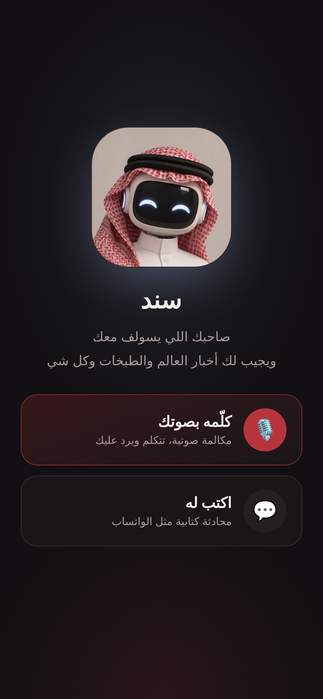
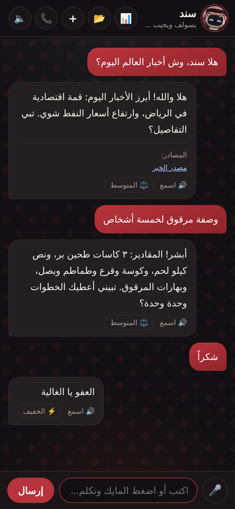
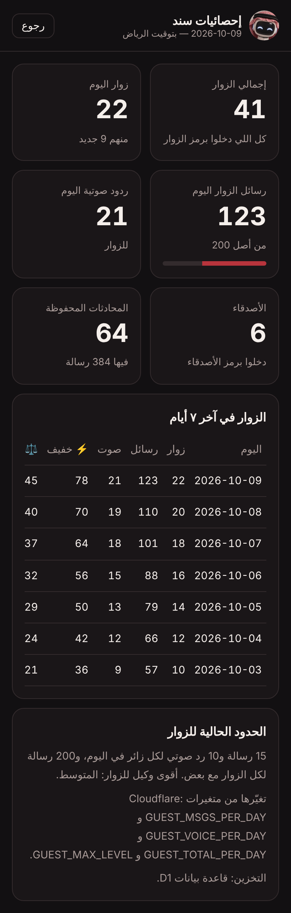
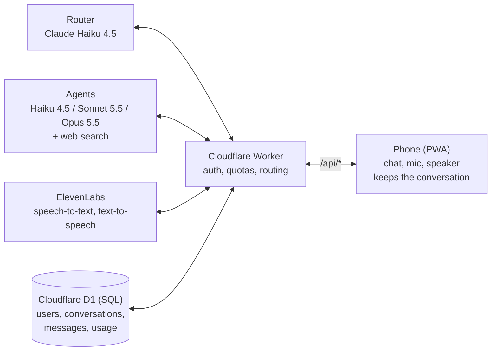

  

<h1 align="center">Sanad · سند</h1>

  A Saudi-dialect AI voice assistant: talk to it in your voice, and it answers back in a natural Saudi voice. 
  <b>مساعد ذكاء اصطناعي يسولف بالسعودي، كتابة وصوت</b>

  
  
  
  

---

## Screenshots

| Start | Chat | Voice call | Owner stats |
| --- | --- | --- | --- |
|  |  |  |  |

*(The stats screenshot uses sample data.)*

## Features

- **Voice-to-voice calls**: the user speaks, Sanad detects when they stop talking, transcribes, answers and speaks back in a Saudi voice, then listens again.
- **Multi-agent routing**: a lightweight router classifies every message and sends it to the cheapest agent that can handle it.
- **Deep reasoning**: the Standard and Expert agents use adaptive thinking, plus a code sandbox to compute and verify math.
- **Photos and PDFs**: send a picture of a math problem, a bill or a document and ask about it (images are resized on the phone before upload).
- **Gender-aware Saudi Arabic**: Sanad addresses the user with feminine or masculine forms, guessed on-device from voice pitch or set manually; no audio is stored.
- **Live web search** for news and anything time-sensitive, with cited sources.
- **Saudi identity end to end**: replies are always in Saudi dialect (even if the user writes in English), plus a configurable pronunciation list for the voice.
- **Saved conversations** in a SQL database (Cloudflare D1): reopen or delete past chats; the owner's history syncs across devices.
- **Three access levels**: owner (unlimited + analytics), friends (unlimited), guests (daily limits).
- **Guest access** with exact per-visitor and global daily limits, and an owner-only analytics page.
- **Installable PWA** for iPhone and Android.
- **Security hardening**: signed sessions, nonce-based CSP, CSRF checks, brute-force lockout, rate limits, input size limits.

## Architecture

The whole app is a single Worker: it serves the page and icons, and handles `/api/login`, `/api/chat`, `/api/stt`, `/api/tts` and the conversation endpoints. Each request carries the recent turns, so the model call itself is stateless; every exchange is also written to D1 so chats can be reopened later. API keys never reach the browser.

### Data model

| Table | Holds |
| --- | --- |
| `users` | One row per visitor (or `owner`), with role and first/last seen |
| `conversations` | Title and timestamps, owned by a user |
| `messages` | Each user/assistant turn, with the agent that answered and its sources |
| `usage` | One row per user per day: messages, voice replies, and counts per agent, incremented atomically with `UPSERT` |

The schema is created automatically on first use. Every conversation query is scoped to the signed-in user, so nobody can read, write into or delete another person's chat.

### Agents

| Agent | Model | Handles | Max output | Searches |
| --- | --- | --- | --- | --- |
| ⚡ Light | Claude Haiku 4.5 | greetings, small talk, simple questions | 1,500 tokens | 3 |
| ⚖️ Standard | Claude Sonnet 5.5 + adaptive thinking | news, recipes, explanations, images, documents | 10,000 tokens | 5 |
| 🧠 Expert | Claude Opus 5.5 + adaptive thinking | math, code, analysis, business planning, important decisions | 20,000 tokens | 8 |

The router (Haiku) reads the last four turns and returns one line of JSON, e.g. `{"level":"hard","search":false}`; when unsure it picks the higher level, and any image or document lifts a light question to Standard. Standard and Expert get web search with dynamic filtering and a code execution sandbox; the Light agent gets basic search only when asked. If an agent is overloaded or unavailable, the request falls back to the next lighter one, and if an advanced option is rejected the same agent retries in plain mode.

### Voice pipeline

1. The page records with `MediaRecorder` and measures loudness (RMS) every 100 ms; 1.3 s of silence after speech ends the turn.
2. `/api/stt` sends the audio to ElevenLabs Scribe (Arabic). Browser speech recognition is the fallback.
3. The reply text is cleaned (no emoji, links or symbols), the pronunciation list is applied, and `/api/tts` returns MP3 from ElevenLabs. The phone's own voice is the fallback.

### Security

| Threat | Mitigation |
| --- | --- |
| Forged session | HMAC-SHA256 signed cookie (role + visitor id); changing a code invalidates all sessions |
| Token theft via script | `HttpOnly`, `Secure`, `SameSite=Strict` cookie |
| Code guessing | Lockout after 6 failures per IP for 15 minutes, delayed failures, constant-time comparison |
| CSRF | `Origin` and `Sec-Fetch-Site` checks on every POST |
| XSS | Per-request nonce CSP, replies rendered with `textContent`, non-http(s) source links dropped |
| Clickjacking | `X-Frame-Options: DENY`, `frame-ancestors 'none'` |
| Cost abuse | Guest daily caps, guests limited to the Standard agent, request and input size limits |
| Reading others' chats | Every conversation query filters by the session's user id; foreign ids return 404 |

## Secrets

No API key, code or password is stored in this repository or sent to the browser. They live only as encrypted **Cloudflare Worker secrets** and are read on the server at request time. An automated test fails the build if anything that looks like a key or a personal email is committed.

## Tests

27 automated tests run on every push via GitHub Actions. The database tests run the real SQL against SQLite. Covered: agent routing and fallback, thinking and tool settings per agent, image and PDF attachments, gender-aware addressing, saved conversations and ownership checks, friend and guest limits, stats, forged-session rejection, CSRF, brute-force lockout, CSP headers, link filtering, pronunciation fixes, and a scan that blocks committed secrets.

## Roadmap

- Streaming replies and sentence-by-sentence speech for lower latency
- Real-time duplex voice over WebSockets
- Durable Objects for strict per-IP rate limits
- WhatsApp channel and per-business knowledge for customer-service use

## Source code

This repository is a showcase. The source code is private; it is available to employers and collaborators on request.

## Author

Designed and built by **Reema Ghazi**.

## License

© 2026 Reema Ghazi. All rights reserved. The code is shared for viewing; please ask before reusing it.
