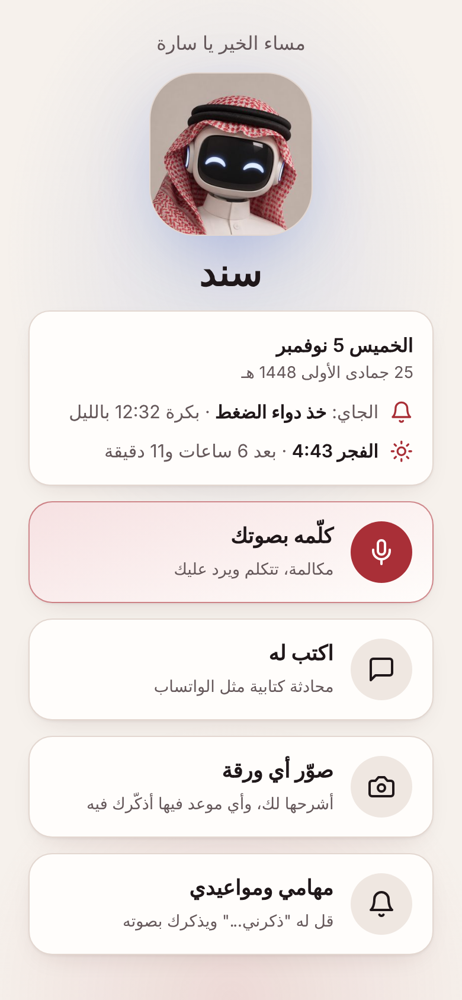
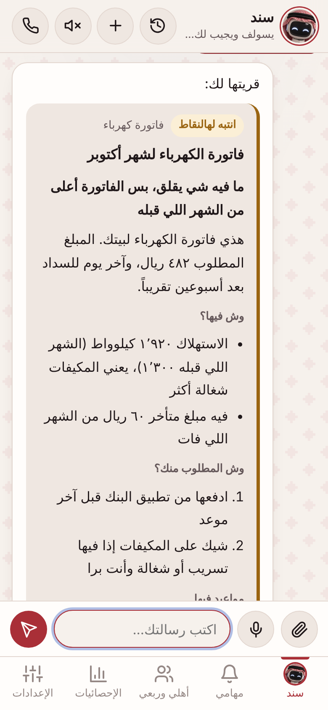
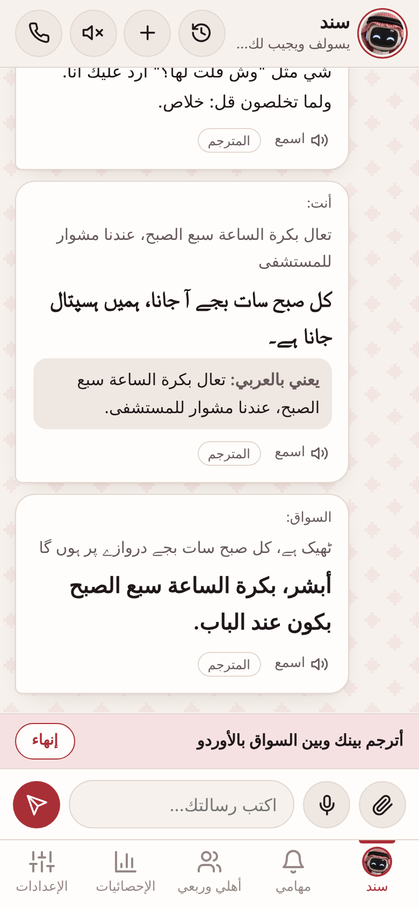
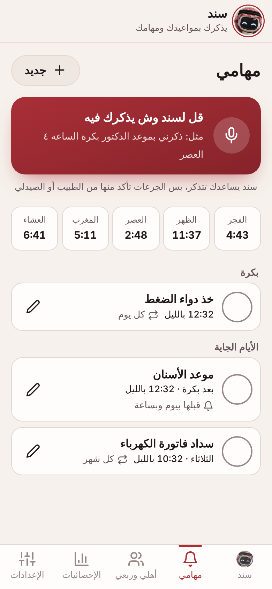
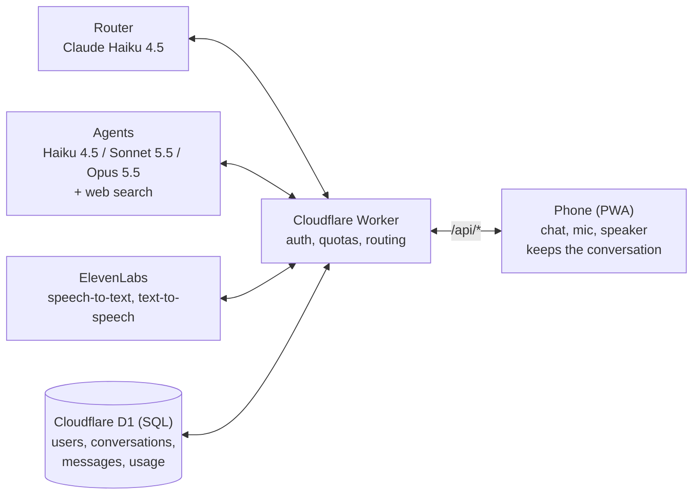

  

<h1 align="center">Sanad · سند</h1>

  A Saudi-dialect AI voice assistant: talk to it in your voice, and it answers back in a natural Saudi voice. 
  <b>مساعد ذكاء اصطناعي يسولف بالسعودي، كتابة وصوت</b>

  
  
  
  

---

## Screenshots

| Start | Photograph any paper | Interpreter | Reminders |
| --- | --- | --- | --- |
|  |  |  |  |

*(Screenshots use sample data.)*

> **Version 2.** The first version ([version 1](https://github.com/r8jfi/sanad/tree/693ea34)) was a chat and voice assistant. Version 2 turns Sanad into a daily helper for the whole family: reminders by voice that reach the phone even when the app is closed, reminding your parents and seeing whether they did it, photographing any paper to have it explained, a face-to-face interpreter, adhkar, and an owner dashboard.

## Features

- **Voice-to-voice calls**: the user speaks, Sanad detects when they stop talking, transcribes, answers and speaks back in a Saudi voice, then listens again.
- **Multi-agent routing**: a lightweight router classifies every message and sends it to the cheapest agent that can handle it.
- **Deep reasoning**: the Standard and Expert agents use adaptive thinking, plus a code sandbox to compute and verify math.
- **Photos and PDFs**: send a picture of a math problem, a bill or a document and ask about it (images are resized on the phone before upload).
- **Gender-aware Saudi Arabic**: Sanad addresses the user with feminine or masculine forms, guessed on-device from voice pitch or set manually; no audio is stored.
- **Live web search** for news and anything time-sensitive, with cited sources.
- **Saudi identity end to end**: replies are always in Saudi dialect (even if the user writes in English), plus a configurable pronunciation list for the voice.
- **Saved conversations** in a SQL database (Cloudflare D1): reopen or delete past chats; the owner's history syncs across devices.
- **Visitors and friends, kept apart**: anyone can try Sanad with just their name (10 messages and 10 voice replies a day). The owner gets a "الناس" page listing friends, visitors (how they joined, who invited them, today's use) and blocked accounts, and can make any visitor a friend (no limits), turn them back into a visitor, or block them. Roles live in the database, so changes take effect on the person's next request. An old `FRIEND_CODE` still works.
- **Remind someone by phone number**: type their number and what you call them ("أمي"); WhatsApp opens on their chat with a ready message and a link (valid a week). They write their name, are linked, and every reminder you send reaches their phone as a notification. The number is only used to open WhatsApp and is never sent to the server.
- **Photograph any paper ("صوّر أي ورقة")**: one camera button on the home screen. Photograph an appointment card or wedding invitation, a medical report or lab result, a bank or government letter, a contract, a bill or an SMS. Sanad says in plain Saudi words what it is, whether anything is worrying (ok / pay attention / important / scam), what to do and by when, and turns any dates in it into reminders with one tap. Scam texts are flagged with what to do if a link was already opened.
- **Interpreter, inside the chat and the call**: "ترجم بيني وبين السواق بالأوردو" (or the housemaid, a doctor...). From then on every turn is translated both ways and spoken: Arabic to the other person's language, their reply back to Saudi Arabic. Speech recognition detects who is talking. No self-introduction; under each translation Sanad shows in Arabic exactly what it told them, and questions to Sanad ("وش قلت لها؟") are answered in Arabic instead of translated. 19 languages including Oromo; Urdu is spoken through Hindi with the default voice model, and languages the voice can't say are shown on screen. "خلاص" or the إنهاء button ends it.
- **Adhkar and wird**: "اقرأ علي أذكار المساء" shows the morning, evening or sleep adhkar (fixed texts from Hisn al-Muslim, never generated) with a counter on each. Sanad reads them with you one by one: in a call anything you say moves to the next, otherwise finishing the count does. Quran passages are shown to read and are not recited by the synthetic voice. "وقفت عند سورة الكهف صفحة ٢٩٤" saves your place; "وين وقفت؟" tells you. A daily "أذكار الصباح" reminder opens them with one tap.
- **One-step invites**: an invite link opens a single page ("علي يبيك معه في سند"): type your name, press انضم, and you're in and linked; the inviter is told. Invites the owner sends make people friends; invites from anyone else make them visitors. An invite code typed into the sign-in box is recognised and redirected.
- **Your data and safety**: sign-up is just a name. In Settings: download my data (JSON), contact/report, and delete my account (removes chats, reminders, voice notes, links, push subscriptions, profile). People can report, block and unblock anyone linked to them (unblocking restores the link and their upcoming reminders); the owner is notified and handles reports in "الناس". A reminder someone sends you arrives straight away as a notification, like a message, and plays a sound in the app. The chat says plainly that Sanad is an AI that can make mistakes, and medicine reminders carry a "check with your doctor or pharmacist" note.
- **Readable stats**: the day in one sentence, plain-language tiles, a 7-day chart, the kinds of questions asked and who used Sanad most, with technical details tucked away.
- **Guest trial** with exact per-visitor, per-connection (hashed, so clearing cookies doesn't reset it) and global daily limits, and an owner-only analytics page.
- **Reminders and tasks by voice**: say "ذكرني بموعد الدكتور بكرة الساعة ٤ العصر" and Sanad saves it and confirms it out loud. One-off, daily, weekly, monthly or every few hours (medicine), with an optional voice note.
- **Notifications even when the app is closed** (Web Push, VAPID + aes128gcm written with Web Crypto, no library), with "تم" and "أجّل ١٠ دقايق" buttons. When the app is open the reminder rings full-screen and is read aloud: "تذكير. موعد الدكتور. اليوم الأحد 25 أكتوبر، الساعة 4 العصر".
- **Heads-ups before the time**: "ذكّرني قبلها" with any of 10 min, 30 min, 1 h, 2 h, a day or a week (several at once). Said by voice too ("وذكرني قبلها بيوم"); appointments and events get sensible defaults when nothing is said. Repeating reminders get them for every occurrence.
- **Undo**: a mistaken "تم" shows an "تراجع" button that restores the reminder exactly (including a skipped repeat); finished ones can be put back with one tap.
- **Friends**: a friend code links two people both ways, so they can remind each other; group reminders go to several people at once.
- **Family reminders**: a parent shares a 6-character code; their son or daughter links once, then says "ذكّر أبوي بموعد المستشفى بكرة". The parent gets "تذكير من محمد"; the child sees whether it was confirmed, and is alerted if it wasn't within 30 minutes.
- **Morning summary** at 7:00 ("صباح الخير، عندك اليوم شيئين: ...") and Umm al-Qura **prayer times** for 24 Saudi cities, with Gregorian and Hijri dates.
- **Opening animation**: Sanad walks in (2.3 s, 1080×1920, H.264, no sound), the name fades in, one tap skips it. Not replayed on refresh or when a notification opens a reminder; can be turned off in Settings. Served with byte ranges so iPhones play it.
- **First open**: a short welcome asks the name (Sanad then uses it in chat, greetings and spoken reminders), how to address the user, and their city.
- **Built for every age**: light and dark themes, three text sizes, a simple mode with fewer and bigger controls, adjustable speech speed, 44 px+ touch targets.
- **Installable PWA** for iPhone and Android.
- **Security hardening**: signed sessions, nonce-based CSP, CSRF checks, brute-force lockout, rate limits, input size limits.

## Architecture

The whole app is a single Worker: it serves the page and icons, and handles `/api/login`, `/api/chat`, `/api/stt`, `/api/tts` and the conversation endpoints. Each request carries the recent turns, so the model call itself is stateless; every exchange is also written to D1 so chats can be reopened later. API keys never reach the browser.

### Data model

| Table | Holds |
| --- | --- |
| `users` | One row per visitor (or `owner`), with role and first/last seen |
| `conversations` | Title and timestamps, owned by a user |
| `messages` | Each user/assistant turn, with the agent that answered and its sources |
| `usage` | One row per user per day: messages, voice replies, and counts per agent, incremented atomically with `UPSERT` |

The schema is created automatically on first use and documented in `schema.sql`. Every conversation query is scoped to the signed-in user, so nobody can read, write into or delete another person's chat.

### Agents

| Agent | Model | Handles | Max output | Searches |
| --- | --- | --- | --- | --- |
| ⚡ Light | Claude Haiku 4.5 | greetings, small talk, simple questions | 1,500 tokens | 3 |
| ⚖️ Standard | Claude Sonnet 5.5 + adaptive thinking | news, recipes, explanations, images, documents | 10,000 tokens | 5 |
| 🧠 Expert | Claude Opus 5.5 + adaptive thinking | math, code, analysis, business planning, important decisions | 20,000 tokens | 8 |

The router (Haiku) reads the last four turns and returns one line of JSON, e.g. `{"level":"hard","search":false}`; when unsure it picks the higher level, and any image or document lifts a light question to Standard. Standard and Expert get web search with dynamic filtering and a code execution sandbox; the Light agent gets basic search only when asked. If an agent is overloaded or unavailable, the request falls back to the next lighter one, and if an advanced option is rejected the same agent retries in plain mode.

### Voice pipeline

1. The page records with `MediaRecorder` and measures loudness (RMS) every 100 ms; 1.3 s of silence after speech ends the turn.
2. `/api/stt` sends the audio to ElevenLabs Scribe (Arabic). Browser speech recognition is the fallback.
3. The reply text is cleaned (no emoji, links or symbols), the pronunciation list is applied, and `/api/tts` returns MP3 from ElevenLabs. The phone's own voice is the fallback.

### Security

| Threat | Mitigation |
| --- | --- |
| Forged session | HMAC-SHA256 signed cookie (role + visitor id); changing a code invalidates all sessions |
| Token theft via script | `HttpOnly`, `Secure`, `SameSite=Strict` cookie |
| Code guessing | Lockout after 6 failures per IP for 15 minutes, delayed failures, constant-time comparison |
| CSRF | `Origin` and `Sec-Fetch-Site` checks on every POST |
| XSS | Per-request nonce CSP, replies rendered with `textContent`, non-http(s) source links dropped |
| Clickjacking | `X-Frame-Options: DENY`, `frame-ancestors 'none'` |
| Cost abuse | Guest daily caps, guests limited to the Standard agent, request and input size limits |
| Reading others' chats | Every conversation query filters by the session's user id; foreign ids return 404 |
| Reminding strangers | A reminder for someone else needs a family link they created (code valid 48 h, wrong codes count toward the lockout); either side can unlink |
| Push as an SSRF vector | Subscriptions are accepted only for real push services (Apple, Google, Mozilla, Microsoft) over https |

## Source code

The source code is private. No API key or password is ever stored in the code or sent to the browser; they live only as encrypted Cloudflare Worker secrets. If you'd like to see the code or work together, contact me.

## Tests

70 automated tests. The database tests run the worker's real SQL against Node's built-in SQLite, and the push tests decrypt every notification and verify its VAPID signature like a real push service would. Covered: reminders (create, edit, done, snooze, repeat, monthly edge cases), "ذكرني" in chat, family linking and permissions, cron delivery, follow-ups and the morning summary, push host allow-list, voice notes, agent routing and fallback, thinking and tool settings per agent, image and PDF attachments, gender-aware addressing, saved conversations and ownership checks, friend and guest limits, stats, forged-session rejection, CSRF, brute-force lockout, CSP headers, link filtering and pronunciation fixes.

## Roadmap

- Streaming replies and sentence-by-sentence speech for lower latency
- Real-time duplex voice over WebSockets
- Durable Objects for strict per-IP rate limits
- Native iPhone and Android app, with reminders that ring like a call inside the app
- WhatsApp channel and per-business knowledge for customer-service use
- Prayer-time notifications before the adhan

## Author

Designed and built by **Reema Ghazi**.

## License

© 2026 Reema Ghazi. All rights reserved.
